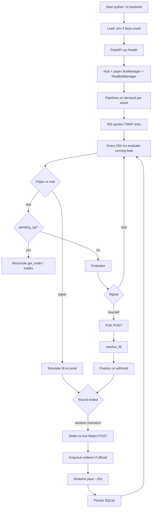

# Operation flow

What the process actually does. Steps from the template that **do not exist** are called out.

## 1. Start

- Entry: `python -m backend` (`backend/__main__.py`) or `uvicorn backend.main:app`.
- `run.py` is the same bind (`0.0.0.0`, `PORT` or 8010).
- Lifespan: HTTP accepts immediately; services boot in a background task (`GOODFALLEN accepting HTTP`).

## 2. Read configuration

- `_load_dotenv()` in `auth.py` fills os.environ from `.env` **only for keys not already set**.
- `CONFIG` in `backend/config.py` is frozen defaults (endpoints, window, backoff). Not overridable via `.env` except `PORT`, `DATA_DIR`, secrets listed in [CONFIGURATION.md](CONFIGURATION.md).

## 3. Environment check

- No dedicated preflight in the app. `/health` reports `ok`, `auth`, `ready`, bot count, `storage` (`data_dir_status`).
- `scripts/_v2_preflight.py` is a manual script, not started with the server.

## 4. Connect to APIs

- Binance trade WS, PolyBolt (needs CLOB-derived creds), Gamma REST discovery every 15 s, CLOB market WS for the current round’s token ids.
- Account Data API v2 for UI cash/positions/trades (`/v2/value`, `/v2/positions`, `/v2/trades`).
- Relayer used for gasless redeem on deposit/proxy wallets.

## 5–7. Markets and book

- `parse_live_market` picks the live 5m Gamma event. v2 markets use `positionIds`; v1 uses `clobTokenIds`. Dual protocol is intentional.
- Quotes from CLOB market WS. Strategy uses top of book only.

## 8. Evaluate

- Paper and real loops ~250 ms.
- Real order: drain redeem notes → skip `asset==ALL` copy → retain pipeline → periodic cash sync → redeem schedule → if `pending_op` reconcile → correct provisional settle → if position window ≠ current, `_close_stale` (settle) → lock profit 99¢ → evaluator.

## 9. Place orders

- Paper: in-memory fill; decrement simulated book size.
- Real: persist `pending_op` **before** POST (`_begin_intent`). `place_market_order(..., order_type="FOK")`. BUY amount is USD; SELL is shares (99.9% of held). **No retry POST.**

## 10. Fills

- `resolve_fill`: `get_order` + `list_account_trades(id=)`. Unparsed `UnexpectedResponseError` → unproven, sell withheld until later proof.
- Confirmed 0 shares is not booked as a round loss.

## 11. Amend / cancel

- **Not implemented** as cancel/replace. FOK either fills fully or dies. Mid-round exits send a new FOK sell.

## 12. Window close

- Live does **not** POST flatten at window end (`_close_stale`). Dust remainders settle instead of selling.

## 13. Settlement

See [STRATEGIES.md](STRATEGIES.md). Official win/loss; provisional local; VOID after 10 min without refund.

## 14. Redemption

- Official non-provisional SETTLE → `_enqueue_redeem` (`condition_id` preferred).
- Pass every ~20 s, batch 5, skip tokens still held by a running bot on that account.
- One running live bot on the account can redeem the whole wallet.
- Bare CLOB token ids that are not V2 position ids are **skipped** (not retried forever).
- Success: activity `REDEEM {side} {size} sh tx {hash}`. Cash updates on next balance sync.

## 15. Persist

- `storage.save_bot` / `save_real_bot` / trades / rounds in SQLite `data/goodfallen.db`.
- Dirty bots flushed periodically.

## 16. Telegram report

**Not implemented.** No messages are sent.

## 17. Next window

- Runtime `rt` resets `entries`, `switches`, `adverse_since` when `window_id` changes.

## 18–19. Errors and retry

- Feeds: reconnect with backoff forever.
- FOK reject: log error, clear pending, no second POST.
- Transport after send: `unknown_send_result` / `pending_op` until reconcile or 90 s give-up against share balance.
- Geoblock: CLOB `Trading restricted in your region` — operator must use an allowed IP. App has no geoblock bypass.

## 20. Stop on limit or STOP file

**Not implemented.** Stop = UI STOP or kill process. Paper STOP attempts a simulated flatten sell if a position is open. Real STOP does not flatten at window end (settlement path). Unfinished `pending_op` still blocks across restart until reconcile.
