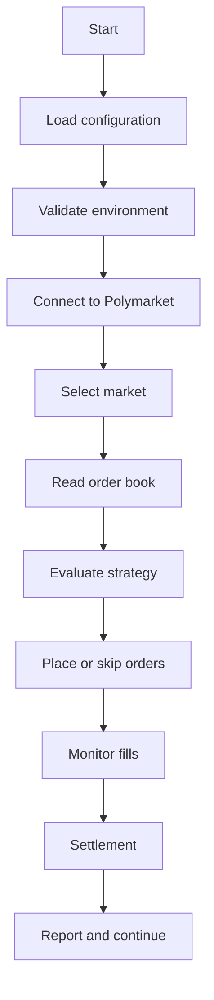

Нужно подготовить production-документацию для коммерческой продажи Polymarket-бота  на английском и собрать достоверную базу знаний для AI-саппорта/RAG.

Работай только на основании исходного кода, конфигурации, существующих комментариев, тестов и фактического поведения приложения. Не выдумывай стратегии, параметры, команды, зависимости или возможности. Если функция частично реализована или не подтверждается кодом — явно пометь её как “not verified” или “not implemented”.

Перед написанием документации:

1. Изучи структуру репозитория.
2. Найди точку запуска приложения.
3. Найди все конфигурационные параметры и `.env`-переменные.
4. Найди торговую логику, обработчики рынков, стратегии, фильтры, лимиты и условия входа/выхода.
5. Найди логику paper/live mode.
6. Найди работу с wallet/private key/API credentials.
7. Найди обработку ошибок, retry, reconnect, rate limits и аварийную остановку.
8. Найди механизм settlement/redemption.
9. Найди Telegram-уведомления и все типы сообщений.
10. Найди требования к Python, ОС, библиотекам, Docker/VPS и системным сервисам.
11. Найди тесты, примеры конфигурации и существующие инструкции.
12. Проверь, какие функции реально используются в production, а какие являются экспериментальными или неактивными.

Не включай в документацию:

- реальные private keys;
- seed phrases;
- API keys;
- токены Telegram;
- пароли;
- реальные секреты из `.env`;
- персональные данные;
- непроверенные обещания доходности.

Создай или обнови следующую структуру документации:

doc/

  [README.md](http://README.md)

  INSTALL_[LINUX.md](http://LINUX.md)

  INSTALL_[WINDOWS.md](http://WINDOWS.md)

  [CONFIGURATION.md](http://CONFIGURATION.md)

  [STRATEGIES.md](http://STRATEGIES.md)

  OPERATION_[FLOW.md](http://FLOW.md)

  RISK_[MANAGEMENT.md](http://MANAGEMENT.md)

  PAPER_[TRADING.md](http://TRADING.md)

  LIVE_[TRADING.md](http://TRADING.md)

  [TELEGRAM.md](http://TELEGRAM.md)

  [TROUBLESHOOTING.md](http://TROUBLESHOOTING.md)

  [SECURITY.md](http://SECURITY.md)

  [UPDATES.md](http://UPDATES.md)

  [FAQ.md](http://FAQ.md)

  SUPPORT_[RAG.md](http://RAG.md)

Также создай:

.env.example

support/

  knowledge-base/

```
[001-overview.md](http://001-overview.md)

[002-installation-linux.md](http://002-installation-linux.md)

[003-installation-windows.md](http://003-installation-windows.md)

[004-configuration.md](http://004-configuration.md)

[005-strategies.md](http://005-strategies.md)

[006-operation-flow.md](http://006-operation-flow.md)

[007-paper-trading.md](http://007-paper-trading.md)

[008-live-trading.md](http://008-live-trading.md)

[009-risk-management.md](http://009-risk-management.md)

[010-telegram.md](http://010-telegram.md)

[011-errors.md](http://011-errors.md)

[012-security.md](http://012-security.md)

[013-faq.md](http://013-faq.md)
```

  knowledge-base.jsonl

  [knowledge-base-index.md](http://knowledge-base-index.md)

Если в проекте уже есть README или документация, не удаляй полезную информацию. Улучши и структурируй её.

==================================================

1. Production README

==================================================

Подготовь полноценный [README.md](http://README.md) для покупателя и оператора бота.

README должен содержать:

- что делает бот;
- для каких рынков он предназначен;
- какие режимы работы существуют;
- что входит в поставку;
- что бот НЕ делает;
- требования к системе;
- краткую архитектуру;
- быстрый старт;
- ссылку на подробную установку;
- запуск paper mode;
- переход в live mode;
- настройку Telegram;
- настройку лимитов риска;
- остановку бота;
- обновление;
- troubleshooting;
- security warnings;
- legal/risk disclaimer.

Не используй маркетинговые обещания гарантированной прибыли. Чётко укажи, что торговля связана с риском потери капитала.

==================================================

2. Установка Linux

==================================================

Создай подробную инструкцию для Ubuntu/Debian-подобной системы.

Покажи только команды, подтверждённые проектом.

Раскрой:

- рекомендуемую версию Linux;
- рекомендуемую версию Python;
- установку системных пакетов;
- клонирование или распаковку проекта;
- создание virtual environment;
- установку зависимостей;
- создание `.env`;
- минимальную конфигурацию;
- проверку paper mode;
- запуск бота;
- просмотр логов;
- остановку;
- автозапуск после перезагрузки;
- systemd, если это совместимо с проектом;
- обновление;
- резервное копирование конфигурации;
- проверку времени и timezone;
- firewall/network requirements;
- типичные ошибки.

Если systemd не поддерживается напрямую, не выдумывай unit-файл. Сначала проверь реальную точку запуска и создай unit только после подтверждения.

==================================================

3. Установка Windows

==================================================

Создай инструкцию для Windows 10/11 и PowerShell.

Раскрой:

- установку Python;
- проверку PATH;
- распаковку проекта;
- создание virtual environment;
- установку зависимостей;
- создание `.env`;
- запуск paper mode;
- запуск live mode;
- просмотр логов;
- корректную остановку;
- автозапуск через Task Scheduler или другой реально совместимый способ;
- работу из PowerShell;
- разрешения Windows;
- firewall;
- кодировку терминала;
- типичные ошибки.

Все команды должны быть проверены на соответствие проекту. Не предлагай Docker, WSL или NSSM, если проект фактически не требует или не поддерживает их.

==================================================

4. Конфигурация

==================================================

Создай [CONFIGURATION.md](http://CONFIGURATION.md).

Собери все переменные конфигурации в таблицу:

| Variable | Required | Default | Allowed values | Meaning | Example | Risk |

|----------|----------|---------|----------------|---------|---------|------|

Для каждой переменной укажи:

- обязательна ли она;
- значение по умолчанию;
- допустимый формат;
- влияние на торговлю;
- можно ли менять во время работы;
- требуется ли перезапуск;
- безопасное значение для paper mode;
- безопасное значение для live mode.

Отдельно выдели:

- API credentials;
- wallet/private key;
- market selection;
- dry-run/paper mode;
- budget/size;
- exposure limit;
- daily loss limit;
- fee/rebate settings;
- Telegram settings;
- logging;
- retry/reconnect;
- timing/window parameters;
- redemption/settlement settings.

Сделай безопасный `.env.example` без секретов.

==================================================

5. Все стратегии и торговая логика

==================================================

Создай [STRATEGIES.md](http://STRATEGIES.md).

Это критически важно: опиши только реально существующие в коде стратегии и режимы.

Для каждой стратегии или логического режима укажи:

- название;
- где реализована;
- какие рынки поддерживает;
- какие условия запуска;
- какие данные использует;
- какие ордера выставляет;
- как рассчитывается размер позиции;
- покупает ли одну сторону или обе стороны;
- как обрабатываются цены;
- как учитываются комиссии;
- как учитываются rebates;
- когда прекращается выставление ордеров;
- когда позиция считается завершённой;
- как работает settlement;
- какие есть ограничения;
- какие риски;
- paper/live differences;
- конфигурационные параметры;
- связанные функции и файлы.

Обязательно раздели:

A. Реально активные стратегии.

B. Реализованные, но отключённые стратегии.

C. Экспериментальный код.

D. Только конфигурационные режимы.

E. Возможности, которых в коде нет.

Не называй стратегию “arbitrage”, “market making”, “hedging”, “momentum” или другим термином, если это не подтверждено фактической логикой кода. Если используется покупка обеих сторон, опиши точную механику без преувеличений.

==================================================

6. Порядок работы бота

==================================================

Создай OPERATION_[FLOW.md](http://FLOW.md).

Опиши полный жизненный цикл процесса:

1. запуск;
2. чтение конфигурации;
3. проверка окружения;
4. подключение к API;
5. получение рынков;
6. выбор подходящего рынка;
7. получение order book;
8. расчёт условий;
9. выставление ордеров;
10. отслеживание fills;
11. корректировка или отмена ордеров;
12. закрытие окна;
13. settlement;
14. redemption;
15. запись состояния;
16. отправка Telegram-отчёта;
17. переход к следующему окну;
18. обработка ошибки;
19. retry;
20. остановка по лимиту или STOP-файлу.

Добавь Mermaid diagram, если она корректно отражает фактическую логику:

